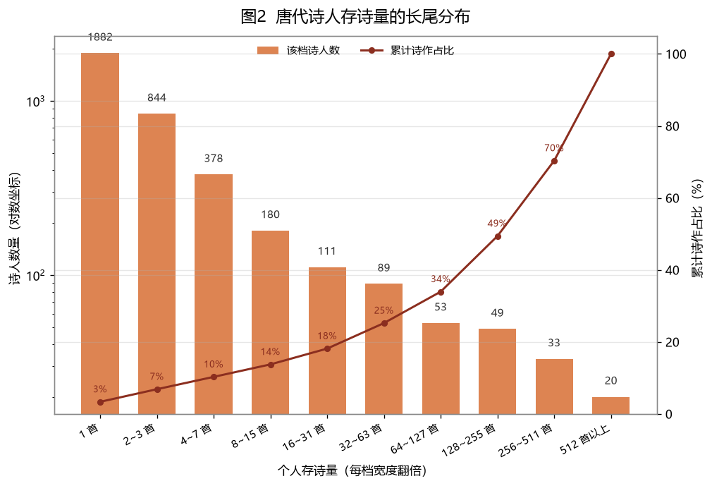
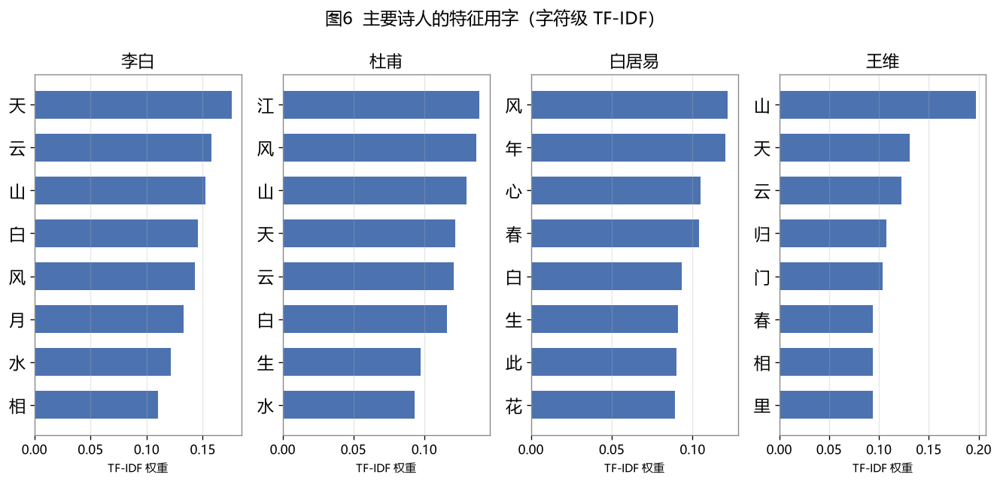

# 全唐诗的数字画像

> 用 pandas 读 57,598 首唐诗，回答三个问题：谁写得多、写什么、谁跟谁来往。

一个课程作业规模的数据分析项目：从原始 JSON 到清洗、统计、可视化，走完整条链路，全程约 13 秒跑完，输出 8 张图、13 张统计表。



---

## 三个问题

| 问题 | 结论 | 图 |
|---|---|---|
| **谁写得多？** | 白居易 3,009 首居首；51.7% 的诗人一生只留下 1 首 | 图 1、图 2 |
| **写什么？** | 第一意象是「水」（覆盖率 34.4%），不是印象中的「月」（19.6%） | 图 4、图 5 |
| **谁跟谁来往？** | 姚合是核心节点（赠出 45、收到 7）；全部关系里 91.5% 是单向的 | 图 7 |

几个值得一看的数字：

- 存诗 1~63 首的前六档共 3,484 人，占诗人总数的 **95.7%**，却只贡献 **25%** 的诗作
- 存诗 512 首以上的 20 人，独占 **30%** 的诗作
- 李白排头的特征字是「天」，杜甫是「江」，王维是「山」——算法没读过文学史，算出的差别与文学史评价吻合
- 按每千字「秋」字密度排序，许浑（10.39）排第一，正是写「山雨欲来风满楼」那位

<p align="center">
  
</p>

---

## 快速开始

```bash
pip install -r requirements.txt
```

然后把数据放进 `data/json/`（见下一节），运行：

```bash
cd src
python main.py
```

结果写到 `output/`：`fig1~fig8*.png` 和 `M1~M5_*.csv`。

---

## 数据从哪来

本项目**不收录原始数据**（24 MB，且版权属原项目）。请自行获取：

1. 打开 [chinese-poetry/chinese-poetry](https://github.com/chinese-poetry/chinese-poetry)
2. 进入 `全唐诗/` 目录，下载其中的 `poet.tang.*.json`（58 个分片，约 24 MB）
3. 全部放进 `data/json/`

> **文件名必须保持原样**（`poet.tang.0.json`、`poet.tang.1000.json` …），代码用 `poet.tang.*.json` 通配符扫描。

数据格式（每条一首）：

```json
{"author": "李白", "title": "静夜思",
 "paragraphs": ["床前明月光，", "疑是地上霜。"], "id": "..."}
```

---

## 项目结构

```
.
├── src/
│   ├── loader.py      读 JSON、繁转简、清洗、算句数/字数/诗体  194 行
│   ├── features.py    意象词表与季节词表的字频统计             77 行
│   ├── analysis.py    产量、意象、共现、TF-IDF、季节密度       259 行
│   ├── network.py     从诗题抽人名、建赠答网络                 111 行
│   ├── visualize.py   8 张图的绘制                             275 行
│   └── main.py        总入口，按顺序跑完六步                   135 行
├── data/json/         原始分片（需自行下载）
├── output/            运行产物：8 图 + 13 表
└── docs/figures/      README 用的图
```

---

## 几个技术选择

**为什么不用 jieba 分词？**
古诗里一个字常常就是一个完整意思，「明月」拆成「明」「月」反而丢了味道。改用「意象词表 + 字频统计」：方法朴素，但结果可核查、可复现，换个人拿同一张表能算出同样的数。

**为什么繁体不能直接扔？**
简体把「雲」（云彩）和「云」（说）合并了。全转成简体，「诗云」的「云」就会被算成云彩。所以表里留一列繁体原文，所有意象统计都跑繁体，展示给人看的是简体。

**为什么长尾图按 1、2、4、8 分桶？**
存诗量跨三个数量级，等距分桶会把窄档压扁、宽档撑大，反而看不出长尾。改成逐档翻倍，各档在对数尺度上宽度相等，柱高才能横向比较；再叠一条累计诗作占比折线，让「少数人写了多少」一眼可读。

---

## 已知局限

- **赠答网络覆盖率只有 1.2%**（687 / 57,598）。只认诗题里以赠答动词开头、且后面紧跟的诗名能在作者名单里对上的情况；只写官职（「令狐相公」）、夹排行（「李十二白」）、写「友人」的，全部漏掉。图 7 反映的是**显性赠答**的局部，不是完整社交图。
- **十类意象是人工定的**，覆盖面有限。「剑」只占 2.7% 不代表唐人少写剑，可能只是词表没抓到其他说法。
- **四季词表有重叠**：「春」这一档含花、柳，一首秋日咏花的诗会同时计入两季，47.2% 衡量的是「春意词」而非严格季节。
- **TF-IDF 按单字算**，认不出「明月」「长安」这类双字词。
- 数据里没有年代和籍贯，做不了时间演化和地域分布。

---

## 关于代码

选题、指标口径、每个模块要回答什么问题由作者确定；具体代码在 AI 辅助下生成，作者负责运行、核对输出、修正错误。报告中第六节记录的四个问题（佚名写法不统一、分桶宽度不等、特征词被标点占据、网络图不可读）都是实际遇到并修改的。

---

## 数据来源与许可

- 数据：[chinese-poetry/chinese-poetry](https://github.com/chinese-poetry/chinese-poetry)（MIT License）
- 本仓库只包含分析与可视化代码，不包含原始数据

---

## 环境

Python 3.12 · numpy · pandas · matplotlib · opencc-python-reimplemented · networkx · scikit-learn

Windows 11 上完整运行一次约 13 秒（读 24 MB JSON → 出 8 图 13 表）。
